<p align="center"></p>

<p align="center"><a href="README.md">🇬🇧 English</a> · <a href="README.it.md">🇮🇹 Italiano</a></p>

<p align="center">
  
  
  
  
  
</p>

> Capisci cosa un'email dimostra, cosa nasconde e cosa devi verificare — senza caricarla su un server.

<p align="center"><a href="docs/ROADMAP.md"><strong>Roadmap</strong></a> · <a href="SECURITY.md">Sicurezza</a> · <a href="CONTRIBUTING.md">Come contribuire</a> · <a href="LICENSE">Licenza</a></p>

---

## 🇮🇹 Italiano

## Panoramica

**BiteRadar** è un **assistente all'analisi** forense delle email, non un motore di verdetti. Incolli un'email grezza (`.eml`, `.msg` o i soli header) e BiteRadar mostra le evidenze, dichiara cosa non ha potuto verificare e suggerisce l'azione sicura — tutto deterministico e **100% lato client**. L'email contiene dati personali e **non lascia mai il browser**: nessun backend, nessun upload, nessuna AI.

Ha due anime complementari:

1. **Analizzatore forense.** Chi dichiara di aver inviato il messaggio e da dove arriva davvero; cosa riportano **SPF, DKIM e DMARC**, se sono **allineati** e se quell'header è attendibile; i link estratti e resi non cliccabili ("defanged"); gli indizi trovati, ciascuno con il proprio *perché* e i propri *limiti*; e, soprattutto, **cosa non è stato possibile controllare**.
2. **Gioco "Spot the Phish".** Scenari realistici in cui la risposta può essere *legittima*, *phishing* o *"non posso stabilirlo: verifico tramite un altro canale"*, con una **Sfida del giorno** dal risultato condivisibile senza spoiler.

BiteRadar è onesto sui propri limiti per costruzione: **non esiste un esito verde**. Un'analisi pulita significa "nessun segnale evidente con i dati disponibili", mai "questa email è sicura".

## Funzionalità

- **Modello di fiducia** — Contano solo gli `Authentication-Results` aggiunti dal *ricevente fidato*; tutto ciò che è sotto il confine di fiducia è marcato *"riportato, non verificabile"*. Header di autenticazione in conflitto vengono segnalati come possibile contraffazione. Basato su [RFC 8601](https://www.rfc-editor.org/rfc/rfc8601) e [RFC 8617](https://www.rfc-editor.org/rfc/rfc8617) (ARC).
- **Quattro esiti + copertura dell'analisi** — 🔴 segnali forti di rischio · 🟠 elementi sospetti da verificare · ⚪ nessun segnale evidente rilevato · ❔ dati insufficienti. Ogni esito ha icona, etichetta testuale e frase di sintesi: il significato non dipende mai dal solo colore. Un pannello di copertura dichiara sempre cosa è stato analizzato e cosa no.
- **Motore di regole deterministico e versionato** — Ogni regola documenta *evidenza → interpretazione → gravità → qualità dell'evidenza → limiti → spiegazioni legittime*. I gruppi di correlazione evitano che segnali correlati si sommino; il punteggio non è mai mostrato come probabilità o percentuale. Include la **regola BEC** (nome visualizzato aziendale + provider gratuito).
- **Isolamento dei contenuti ostili** — Vista testuale di default; l'HTML, quando aperto, è sanificato e reso dentro un `<iframe sandbox="">` con CSP propria stringente e senza risorse esterne; il parsing gira in un **Web Worker** con limiti di risorse.
- **Privacy by design, imposta tecnicamente** — Nessun upload, nessuna persistenza. Le uniche richieste di rete sono elencate nella pagina privacy e bloccate dalla CSP dell'app (`connect-src`). I report hanno anteprima obbligatoria con oscuramento automatico + manuale prima dell'esportazione.
- **Bilingue (IT/EN) e accessibile** — WCAG 2.1 AA, accesso completo da tastiera, annunci per screen reader e `prefers-reduced-motion`.

Il piano completo, il modello di fiducia e il catalogo delle regole sono nella [roadmap](docs/ROADMAP.md).

## Stack tecnologico

| Area       | Scelta                                                     |
| ---------- | ---------------------------------------------------------- |
| Linguaggio | TypeScript                                                 |
| UI         | React 19                                                   |
| Build tool | Vite                                                       |
| Stile      | Tailwind CSS                                                |
| Stato      | Zustand (in memoria; nessun dato email reso persistente)   |
| `.eml`     | postal-mime                                                |
| `.msg`     | @kenjiuno/msgreader (previsto, v0.2)                       |
| Isolamento | Web Worker + `<iframe sandbox>` + DOMPurify                |
| Test       | Vitest + Playwright                                        |
| Hosting    | Vercel (SPA statica)                                       |

## Struttura del progetto

```
src/
├─ worker/     parsing .eml/.msg nel Web Worker, con limiti di risorse
├─ lib/        modello di fiducia, estrazione URL/IOC, motore di scoring (puro, testato)
├─ rules/      regole: evidenza, interpretazione, gravità, limiti, spiegazioni legittime
├─ content/    scenari del gioco e Sfida del giorno (dati, bilingui, FITTIZI)
├─ report/     esportazione con escaping e oscuramento
├─ components/ Analyzer, OutcomePanel, CoveragePanel, EvidenceList, SandboxedBody, …
├─ i18n/       cataloghi UI tipizzati italiano/inglese
├─ store.ts    stato in memoria (analisi corrente, punteggio, lingua, tema)
└─ types.ts    contratti di tipo condivisi
tests/
└─ corpus/     corpus sintetico etichettato (mai email reali)
```

Regole e scenari sono tenuti come **dati**, separati da logica e UI: aggiungere un segnale o uno scenario significa modificare dati, non codice.

## Avvio rapido

Richiede Node.js 24 LTS (vedi `.nvmrc`) e npm.

```bash
npm ci            # installa le versioni esatte di package-lock.json
npm run dev       # avvia solo su loopback: http://127.0.0.1:3000
npm run build     # build di produzione
npm test          # esegue i test (Vitest)
npm run typecheck # controllo dei tipi TypeScript
npm run lint      # ESLint
```

> **Stato:** questo repository è in fase di scaffolding/progettazione. L'albero `src/` è uno scheletro che rispecchia l'architettura prevista; l'analizzatore e il gioco vengono costruiti seguendo la [roadmap](docs/ROADMAP.md).

## Etica e uso consapevole

Tutti gli scenari del gioco sono **fittizi**: marchi, loghi e persone inventati o parodici, nessuna imitazione di organizzazioni reali. Il repository contiene **solo email sintetiche**, mai file `.eml`/`.msg` reali con dati personali. BiteRadar è un **supporto all'analisi**, non un verdetto tecnico o legale — falsi positivi e negativi sono possibili e vengono spiegati.

## Licenza e termini d'uso

Distribuito con [licenza GNU GPL-3.0](LICENSE). Il progetto può essere utilizzato,
studiato, modificato e ridistribuito mantenendo l'avviso di copyright e licenza.

---

© Chiara Berti — 2026
