<p align="center"></p>

<p align="center"><a href="README.md">🇬🇧 English</a> · <a href="README.it.md">🇮🇹 Italiano</a></p>

<p align="center">
  
  
  
  
  
</p>

> Understand what an email proves, what it hides and what you still need to check — without uploading it anywhere.

<p align="center"><a href="docs/ROADMAP.md"><strong>Roadmap</strong></a> · <a href="SECURITY.md">Security</a> · <a href="CONTRIBUTING.md">Contributing</a> · <a href="LICENSE">Licence</a></p>

---

## 🇬🇧 English

## Overview

**BiteRadar** is an email-forensics **analysis assistant**, not a verdict engine. You paste a raw email (`.eml`, `.msg` or just the headers) and BiteRadar shows the evidence, states what it could not verify, and suggests the safe action — everything deterministic and **100% client-side**. The email carries personal data and **never leaves the browser**: there is no backend, no upload and no AI involved.

It has two complementary halves:

1. **Forensic analyzer.** Who the message claims to be from and where it really comes from; what **SPF, DKIM and DMARC** report, whether they are **aligned** and whether that header can be trusted at all; links extracted and rendered non-clickable ("defanged"); the clues found, each with its own _why_ and its own _limits_; and, crucially, **what could not be checked**.
2. **"Spot the Phish" game.** Realistic scenarios where the right answer may be _legitimate_, _phishing_ or _"I can't tell — I'll verify through another channel"_, plus a **Daily Challenge** with a spoiler-free shareable result.

BiteRadar is honest about its limits by design: there is **no green light**. A clean analysis means "no obvious signals with the available data" — never "this email is safe".

## Features

- **Trust model** — Only the `Authentication-Results` added by the _trusted recipient_ count; everything below the trust boundary is marked _"reported, not verifiable"_. Conflicting authentication headers are flagged as a possible forgery. Based on [RFC 8601](https://www.rfc-editor.org/rfc/rfc8601) and [RFC 8617](https://www.rfc-editor.org/rfc/rfc8617) (ARC).
- **Four outcomes + analysis coverage** — 🔴 strong risk signals · 🟠 suspicious, verify · ⚪ no obvious signals detected · ❔ insufficient data. Each outcome has an icon, a text label and a plain-language summary, so meaning never relies on colour alone. A coverage panel always states what was and was not analysed.
- **Deterministic, versioned rule engine** — Each rule documents _evidence → interpretation → severity → evidence quality → limits → legitimate explanations_. Correlation groups prevent related signals from stacking; the score is never shown as a probability or percentage. Includes the **BEC rule** (corporate display name + free provider).
- **Hostile-content isolation** — Text view by default; HTML, when opened, is sanitised and rendered inside an `<iframe sandbox="">` with its own strict CSP and no external resources; parsing runs in a **Web Worker** with resource limits.
- **Privacy by design, enforced** — No upload, no persistence. The only network requests are listed in the privacy page and enforced by the app CSP (`connect-src`). Reports get a mandatory preview with automatic + manual redaction before export.
- **Bilingual (IT/EN) and accessible** — WCAG 2.1 AA, full keyboard access, screen-reader announcements and `prefers-reduced-motion`.

See the full plan, trust model and rule catalogue in the [roadmap](docs/ROADMAP.md).

## Tech stack

| Area       | Choice                                          |
| ---------- | ----------------------------------------------- |
| Language   | TypeScript                                      |
| UI         | React 19                                        |
| Build tool | Vite                                            |
| Styling    | Tailwind CSS                                    |
| State      | Zustand (in-memory; no email data is persisted) |
| `.eml`     | postal-mime                                     |
| `.msg`     | @kenjiuno/msgreader (planned, v0.2)             |
| Isolation  | Web Worker + `<iframe sandbox>` + DOMPurify     |
| Tests      | Vitest + Playwright                             |
| Hosting    | Vercel (static SPA)                             |

## Project structure

```
src/
├─ worker/     .eml/.msg parsing in a Web Worker, with resource limits
├─ lib/        trust model, URL/IOC extraction, scoring engine (pure, tested)
├─ rules/      rules: evidence, interpretation, severity, limits, legitimate explanations
├─ content/    game scenarios and Daily Challenge (data, bilingual, FICTITIOUS)
├─ report/     export with escaping and redaction
├─ components/ Analyzer, OutcomePanel, CoveragePanel, EvidenceList, SandboxedBody, …
├─ i18n/       typed Italian/English UI catalogs
├─ store.ts    in-memory state (current analysis, score, language, theme)
└─ types.ts    shared type contracts
tests/
└─ corpus/     labelled synthetic corpus (never real emails)
```

Rules and scenarios are kept as **data**, separate from logic and UI: adding a signal or a scenario means editing data, not code.

## Getting started

Requires Node.js 24 LTS (see `.nvmrc`) and npm.

```bash
npm ci            # install the exact versions from package-lock.json
npm run dev       # start on loopback only: http://127.0.0.1:3000
npm run build     # production build
npm test          # run the test suite (Vitest)
npm run typecheck # TypeScript type-check
npm run lint      # ESLint
```

> **Status:** this repository is in the scaffolding/design phase. The `src/` tree is a skeleton that mirrors the planned architecture; the analyzer and the game are built out along the [roadmap](docs/ROADMAP.md).

## Ethics & safe use

All game scenarios are **fictitious**: invented or parodic brands, logos and people, with no imitation of real organisations. The repository contains **only synthetic emails**, never real `.eml`/`.msg` files with personal data. BiteRadar is an **analysis aid**, not a technical or legal verdict — false positives and negatives are possible and explained.

## License & terms of use

Released under the [GNU GPL-3.0 License](LICENSE). You may use, study, modify and
redistribute the project while preserving the copyright and licence notice.

---

© Chiara Berti — 2026
